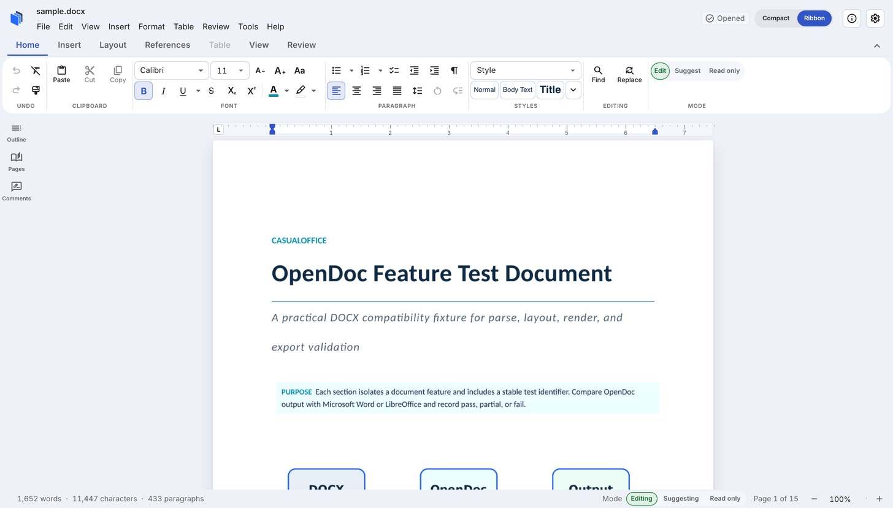

<p align="center">
  
</p>

<h1 align="center">OpenDoc</h1>

<p align="center">
  <strong>An Apache-2.0, embeddable, local-first editor for Word documents —<br />
  and the deterministic Rust engine underneath it.</strong>
</p>

<p align="center">
  <a href="https://opendoc.casualoffice.org"></a>
  <a href="docs/168-WORD-AND-DOCS-RIVAL-PLAN.md"></a>
  <a href="rust-toolchain.toml"></a>
  <a href="LICENSE"></a>
</p>

<p align="center">
  <a href="https://opendoc.casualoffice.org/editor.html?demo=1"><strong>Try the editor</strong></a> ·
  <a href="https://opendoc.casualoffice.org">Website</a> ·
  <a href="https://opendoc.casualoffice.org/embedding.html">Embedding guide</a> ·
  <a href="docs/00-README.md">Docs</a>
</p>

[](https://opendoc.casualoffice.org/editor.html?demo=1)

OpenDoc opens a document into a normalized, editable model, lays it out and paints
it itself, and saves it back. The same Rust engine runs natively, headless, or in
the browser as WebAssembly, so the editor opens, edits and saves a document entirely
in the tab, with no document server behind it.

It is built as an open alternative to ONLYOFFICE Docs for documents and document
collaboration: one you can embed and brand without a commercial licence.

> **About the lists below.** The feature list, the format table and the agent
> surface in this README are generated from the code (`webapp/tools/build-readme.mjs`),
> and CI fails when they no longer match it. What is not listed is not claimed.

## Part of CasualOffice

OpenDoc is one of two sibling projects from [CasualOffice](https://github.com/CasualOffice),
both Apache-2.0, both a Rust engine with a WebAssembly editor:

| Project | What it edits | Links |
| --- | --- | --- |
| **OpenDoc** (this repo) | Documents (Word and OpenDocument text) | [site](https://opendoc.casualoffice.org) · [repo](https://github.com/CasualOffice/opendoc) |
| **[OpenCalc](https://github.com/CasualOffice/opencalc)** | Spreadsheets | [site](https://calc.casualoffice.org) · [repo](https://github.com/CasualOffice/opencalc) |

## Principles

| | |
| --- | --- |
| **Loss-aware** | Content the model does not represent is kept and written back verbatim, or reported in a compatibility report. It is never dropped silently. |
| **Deterministic** | The same input, fonts and engine version produce the same model, layout, pixels and bytes, so rendering is regression-tested rather than judged by eye. |
| **Local-first** | No document server and no upload are required to open, edit or save. |
| **Embeddable** | A custom element, an in-process API and a `postMessage` contract. No React, no DOM-as-model, no mandatory collaboration provider. Host customisation is not behind a licence check. |
| **Bounded on untrusted input** | Packages are parsed under explicit entry, path, size, expansion and resource limits. |

## Three products, one engine

The owner's product split (`docs/176`, ADR-071). All three are pre-release.

| Product | What it is | Where | State |
| --- | --- | --- | --- |
| **Editor SDK** | The browser editor, mounted as `<opendoc-editor>` and driven through the host contract | [`packages/opendoc-embed`](packages/opendoc-embed) (`@casualoffice/opendoc-editor`), [`webapp/`](webapp/) | npm pre-releases under the `next` tag only |
| **Viewer SDK** | Read-only: open, paginate once, render pages to pixels or PNG, page text, outline, PDF; no editing code in the module | [`packages/opendoc-viewer`](packages/opendoc-viewer) (`@casualoffice/opendoc-viewer`), [`crates/opendoc-viewer`](crates/opendoc-viewer) | npm pre-releases under the `next` tag only |
| **Native SDK** | Create, read, modify and convert documents in code | The Rust crates in this workspace (`casual-doc-sdk`, `casual-doc-io`, `casual-doc-ai`, `casual-doc-command`), and the `opendoc-mcp` server | Rust only, unpublished; the Java, Python, .NET and C bindings in `docs/176` are not built |

## What the editor does today

<!-- @generated features -->
<!-- Generated by `webapp/tools/build-readme.mjs` from `docs/153` (itself derived from the code by `tools/opendoc-parity`). Do not edit; `webapp/build.sh` fails when it is stale. -->

<details><summary><strong>Character formatting, clipboard and symbols</strong> — 35 shipped, 14 partial, 3 not yet</summary>

**Shipped:** Bold · Capitalise the first letter of a sentence · Change case · Clear formatting · Copy · Cut · Font colour · Font family · Font size · Format painter · Grow font · Highlight colour · Insert a non-breaking space · Insert emoji · Insert symbol · Italic · Language of the selected text · Paste · Paste as picture · Paste without formatting · Replace text as you type (AutoCorrect table) · Right-to-left text direction · Shrink font · Smart quotes as you type · Special characters (em dash, en dash, ellipsis, copyright, trade mark) · Strikethrough · Subscript · Superscript · Telling the user what a paste dropped · Turn a typed URL into a hyperlink · Turn typed hyphens into dashes · Type a code point and turn it into the character (Alt+X) · Underline · Underline colour · Underline style (double, dotted, dashed, wavy, thick)

**Partial** (what is missing):

- All capitals (as a character effect) — no command applies `w:caps`; `format.case.upper` rewrites the letters instead, which is a different operation
- Borders around text — paragraph borders and shading only; no character-level border (`w:bdr`) control
- Character position (raised / lowered baseline) — no command sets `w:position`; only the fixed superscript and subscript toggles exist
- Character spacing (expanded / condensed) — no command or dialog field sets it — `w:spacing` on a run is imported, laid out and exported only
- Choosing a symbol by font, Unicode range or code — the glyph sets are curated and searchable by name, with no font picker, no Unicode-range picker, no code box and no recently-used row
- Double strikethrough — no command or control applies it — an imported `w:dstrike` run is kept and rendered but cannot be set or cleared
- Drop cap — mode (none/dropped/in-margin) and a line count only — no drop-cap font, distance from text, frame border, margins or exact height
- Font kerning threshold — no command sets `w:kern`
- Horizontal character scaling — no command sets `w:w`; the property is imported, laid out and exported only
- Insert a non-breaking or soft hyphen — no command or shortcut inserts one — `w:noBreakHyphen` and `w:softHyphen` are imported, laid out and exported only
- Keyboard shortcuts for em dash, copyright and friends — no keyboard shortcut inserts a special character — every one of them costs a trip through the picker
- Paste special options after a paste — no post-paste options control — the choice between keep-source-formatting and text-only must be made before pasting, and there is no merge-formatting option at all
- Small capitals — no command or control applies it — `w:smallCaps` is imported, laid out and exported but cannot be turned on
- Text effects (outline, shadow, emboss, engrave) — no command applies outline, shadow, emboss or imprint

</details>

<details><summary><strong>Paragraph formatting, lists and styles</strong> — 50 shipped, 5 partial, 0 not yet</summary>

**Shipped:** Adjust list indents · Align centre · Align left · Align right · Bar tab stop · Bullet library · Bulleted list · Change list level · Checklist · Clear paragraph formatting · Continue numbering · Create a new style from selection · Custom bullet from a symbol · Decimal tab stop · Decrease indent · Default tab stop interval · Distance from text for paragraph borders · Don't add space between paragraphs of the same style · Drag indent markers on the ruler · Exact left and right indent · First-line and hanging indent · Increase indent · Justify · Keep lines together · Keep with next · Left, centre and right tab stops · Line spacing presets · Line spacing rule (multiple / at least / exactly) · Multilevel list · Numbered list · Numbering format library · Page break before · Paragraph advanced settings · Paragraph border line style and width · Paragraph borders (edge presets) · Paragraph outline level · Paragraph shading (background fill) · Place and move tab stops on the ruler · Restart numbering · Right-to-left paragraph direction · Set numbering value · Show non-printing characters · Space before and after a paragraph · Style for the following paragraph · Style gallery and apply style · Suppress line numbers for this paragraph · Tab leader (dots, dashes, underline) · Tab stops dialog · Update style from selection · Widow and orphan control

**Partial** (what is missing):

- Border between paragraphs — adjacent-paragraph border grouping and between-edge painting in the page renderer
- Delete a custom style — deleting a referenced style with reference reassignment
- List settings (per-level bullet, number format, alignment) — marker font, size, color and alignment authoring
- Picture bullet — cropped, transformed and unsupported picture-marker effects
- Restore a built-in style to its default — a factory-default reset independent of the document-open baseline

</details>

<details><summary><strong>Tables</strong> — 44 shipped, 8 partial, 0 not yet</summary>

**Shipped:** AutoFit / fixed column widths · Banded rows and columns, header / total / first / last · Border width and line style · Borders and background dialog with a preview · Cell background colour · Cell vertical alignment · Column width · Contextual Table tab appears when the caret is in a table · Convert table to text · Convert text to table · Delete cells with a shift direction · Delete column · Delete row · Delete table · Distribute columns evenly · Distribute rows evenly · Draw table (freehand grid tool) · Format every cell of a dragged range in one edit · Insert a table inside a table cell · Insert cells with a shift direction · Insert column left / right · Insert row above / below · Insert table from a size grid · Insert table with a typed row and column count · Merge cells · Move a row or column · Numbered table caption · Repeat header row on each page · Resize a row or column from the keyboard · Row height and height rule · Select row, column or whole table · Sort table rows · Spacing between cells · Split a cell into rows and columns · Split a table into two · Tab between cells, and Tab in the last cell adds a row · Table alignment on the page · Table indent from the left · Table position dialog · Table properties surface · Table title and accessibility description · Text direction in a cell · Text wrapping around a table · Undo a cell merge

**Partial** (what is missing):

- Apply a table style — a gallery of built-in table templates; we only offer styles the document already defines
- Cell and table border presets — inside-horizontal and inside-vertical presets on the cell selection
- Cell margins — per-edge values and a per-cell override of the table default
- Erase table borders (eraser tool) — a pointer eraser that removes one border segment by dragging along it
- Preferred table width — a percent-of-page width; ours takes inches only
- Select the current cell — a Select cell command; only a pointer drag produces a cell range
- Table background colour — a table-level shading control; the table is filled by selecting it and shading its cells
- Table formula — a function picker, a number format, bookmark references and recalculation as a field

</details>

<details><summary><strong>Images, shapes, charts and drawings</strong> — 33 shipped, 16 partial, 6 not yet</summary>

**Shipped:** Align selected objects to each other · Align to page or to margin · Bring forward, send backward, to front, to back · Change a shape to a different geometry · Change chart type and style · Chart elements — title, legend, labels, gridlines · Crop a picture by dragging its handles · Distance from text, move with text, allow overlap · Drag out a shape at the size you want · Edit a chart's data · Flip an object horizontally or vertically · Free rotation, by handle or by angle · Group objects · Insert a chart · Insert a picture from a file · Insert a picture from a URL · Insert a text box · Keep the aspect ratio while resizing · Nudge a floating object with the arrow keys · Object properties panel · Position gallery (nine cells) · Put an object back in line with text · Replace a picture's bytes in place · Reset crop · Resize an object with its handles · Restore a picture to its original size · Rotate 90 degrees left or right · Shape shadow · Text box internal margins, vertical anchor and autofit · Text inside a shape · Text wrapping modes · Ungroup · Walk the anchored objects from the keyboard

**Partial** (what is missing):

- Alignment guides and snapping while dragging — snapping to other objects, and to the top and bottom margins
- Alt text on an object — a separate alt-text title field beside the description
- Crop to Fit and Crop to Fill — crop to shape
- Distribute objects horizontally or vertically — distributing two objects across the page or the margin
- Edit a shape's points — adding and deleting points, changing a segment between straight and curved, dragging control handles, refitting the box, and rotated shapes
- Edit the wrap boundary — any editor that moves a wrap-polygon vertex
- Gradient fill — the dark variation and a gradient stop editor
- Insert a shape from a gallery — the rest of the preset catalogue: the engine draws all 187 ECMA-376 presets (docs/109 FID-L-04), but the gallery and insertShape offer the 22 typed ones (FID-SH-04)
- Line arrowheads — an arrowhead size, and a per-end style picker beyond Word's gallery
- Picture border and effects — any control that authors a picture border, shadow or other picture effect
- Position relative to page, margin, column or character — a relative-to chooser and percentage positions; every preset writes relativeFrom margin
- Render an embedded chart — the families `is_drawable` refuses — every `*3DChart`, surface, stock, radar, bubble and pie-of-pie — which keep a text placeholder; and no chart is editable as a chart
- Save a drawing as a picture file — a shape, chart or group rasterised to a file
- Select several objects at once — any command other than Group acting on the held set
- Shape fill — every fill type but a solid swatch, and any custom colour
- Shape outline colour and weight — cap and join type

</details>

<details><summary><strong>Page setup, sections and references</strong> — 56 shipped, 11 partial, 1 not yet</summary>

**Shipped:** Add paragraph to table of contents · Bookmarks · Column break · Columns · Content controls / structured document tags · Convert footnotes to endnotes · Cross-reference · Custom page margins · Custom page size · Different first page · Different odd and even pages · Document property fields (file name, author) · Edit footer · Edit header · Follow a contents entry · Footnote and endnote settings · Go to next or previous note · Header and footer distance from edge · Hyperlink ScreenTip · Insert blank page · Insert caption · Insert endnote · Insert field · Insert footnote · Insert hyperlink · Insert page number · Insert table of contents · Insert text from file · Line between columns · Link to previous · Margin presets (Normal, Narrow, Moderate, Wide) · Mirrored margins · Navigation pane / outline · Page borders · Page break · Page colour · Page number format · Page number position presets · Page orientation · Page size presets (A4, Letter, Legal) · Page thumbnails · Remove header or footer · Remove hyperlink · Remove table of contents · Section break (next page, continuous, even, odd) · Start page numbering at · Tab leader for contents entries · Table of contents levels · Table of contents settings (page numbers, alignment, links) · Table of contents style gallery · Table of figures · Text watermark · Update caption numbers · Update entire table · Update page numbers only · Vertical alignment of a section

**Partial** (what is missing):

- Breadth of the field catalogue — REF, PAGEREF, `SEQ`, `STYLEREF`, NOTEREF, TOC, HYPERLINK and MERGEFIELD as authorable field kinds
- Cross-reference to a numbered item — Numbered item as a reference type
- Date and time field — a format list, a language and an update-automatically switch
- Go to page — typing a page number to jump to it
- Gutter — the gutter position control (left or top)
- Line numbering — the Apply to choice — whole document or this point forward
- Link to a place in this document — linking straight to a heading — only bookmarks are listed
- Picture watermark — the picture half, which ships as a disabled choice carrying its reason
- Promote, demote and add headings from the outline — promote, demote, new heading and select-section from the panel
- Unequal column widths — named Left/Right unequal presets
- Update all fields — a document-wide refresh that covers every field kind

</details>

<details><summary><strong>Review, proofing and collaboration</strong> — 46 shipped, 4 partial, 0 not yet</summary>

**Shipped:** Accept all changes · Accept and move to the next change · Accept the change at the caret · Accessibility checker · Add a comment · Add a word to the personal dictionary · Add-comment affordance in the right margin · AutoCorrect options dialog · Comments panel · Delete a comment · Display mode: final (changes applied, markup hidden) · Display mode: markup (show changes inline) · Display mode: original (document as if every change were rejected) · Display mode: simple markup (change bars only) · Document info and properties panel · Edit a comment or a reply · Filter comments by open, resolved or all · Go to the next / previous change · Grammar check · Ignore all occurrences of a word · Ignore one misspelling · Install and remove proofing language packs · Manage or clear the personal dictionary · Password on the editing restriction · Per-capability permissions a host can withhold · Protect a form so only fields can be filled · Protect the document · Reject all changes · Reject and move to the next change · Reject the change at the caret · Replace text as you type (AutoCorrect table) · Reply to a comment · Resolve a comment thread · Restore an earlier version · Restrict editing to view, comments, forms or tracked changes · Review pane listing every change and comment · Screen-reader-readable document structure · Set the proofing language for the selection · Smart quotes · Spell check as you type · Suggesting mode for a commenter · Turn track changes on/off · Version history · Viewing mode (read-only preview) · Word and character count in the status bar · Word count dialog, including a count for the selection

**Partial** (what is missing):

- Compare two documents — the merged THIRD DOCUMENT. Theirs, and Word's, write the differences into a new document as real tracked changes that can be accepted and rejected; `casual-doc-diff` returns a typed sidecar, so ours is a change LIST in a side panel - Google Docs' answer - and the panel says so before a file is picked rather than leaving a reader to discover it. Turning a sidecar into a merged document is a construction with its own questions (who authors a change, what happens to a move) and is not started.
- See what changed between two versions — the diff is computed nowhere in the editor, so the panel's toggle ships disabled with its reason
- Set the document's proofing language — it is a host preference and a stored setting only, with no in-app picker
- Sharing and access rights — Host-managed Share/join is implemented; invitation access settings backed by a host user directory remain open.

</details>

<details><summary><strong>Files, view, navigation and the shell</strong> — 58 shipped, 8 partial, 4 not yet</summary>

**Shipped:** Assign form fields to roles · Autosave · Change the interface language from inside the editor · Command palette — find any command by name · Command the editor from the host page and hear what it did · Dark document (invert the page, not just the chrome) · Embed the editor in a host page · Export a normalized JSON snapshot of the document · Export as DOCX · Export as HTML · Export as Markdown · Export as ODT · Export as PDF · Export as plain text · Find text · Fit page and fit width · Headings / navigation pane · Insert and configure a content control · Install a proofing language and check spelling offline · Interface theme · Keyboard shortcut reference · Match case · Open a file from the editor · Open a local file with no server · Open a Markdown file as a document · Open an HTML file as a document · Operate the editor from the keyboard alone · Page N of M in the status bar · Page thumbnails pane · Phone and touch layout · Print · Print the selection only · Read and edit document properties · Read and write OOXML directly, not through a converter round-trip · Recover unsaved work after a crash · Rename the open document · Replace and replace all · Run the editor with no document server and no licence check · Save as / download as another format · Save as a Word template (DOTX) · Save the document · Screen-reader support · Search with a regular expression · Search within the selection only · Select all · Show several pages side by side · Start a blank document · Start from a template · Text, combo, drop-down, checkbox, radio, date, image and complex fields · Third-party plugins · Turn spelling and grammar checking on or off · Undo and redo · Version history · Whole words only · Word Count dialog for the selection · Word, character and paragraph counts in the status bar · Zoom in and out · Zoom to a typed percentage

**Partial** (what is missing):

- Choose measurement units (cm, points, inches) — the ruler's own lattice. The preference now ships in Settings, the File menu and the palette, and it governs Page setup, but the ruler still draws inch ticks whatever is chosen - which the dialog says out loud rather than hiding.
- Export as RTF — an RTF writer. `crates/casual-doc-io/src/rtf.rs` declares `can_export: false` and registers no exporter, so the id is absent from `availableExportFormats()` and the File row is disabled carrying that as its reason rather than running an export that throws. RTF IMPORTS fully.
- Go to a page number — a page-number field; you must find the thumbnail, which for a far-away page means scrolling the pane
- Print preview with printer, range, copies and sides — an in-app preview panel with printer, page range, copies, duplex and colour settings
- Set the document or selection language — any control that sets it — the preference exists and a host can set it, but no dialog or status-bar picker offers it to the user
- Show non-printing characters — the toggle in the chrome, and three of the marks
- Show or hide the ruler — a View-band toggle the reader can operate; the ruler is a host-composed region only
- Show or hide the status bar — a user-facing toggle; the status bar is a host-composed region only

</details>

The rows not listed here are the ones neither product has, or the ones only ONLYOFFICE has; [`docs/153`](docs/153-ONLYOFFICE-CAPABILITY-PARITY-MATRIX.md) ranks the open gaps.
<!-- @end features -->

## Formats

What the engine's format registry declares. The editor's Save list is filled from
the same registry at run time.

<!-- @generated formats -->
<!-- Generated by `webapp/tools/build-readme.mjs` from the `FormatDescriptor` each `casual-doc-io` adapter declares, plus anchored PDF-import evidence. Do not edit; `webapp/build.sh` fails when it is stale. -->

| Format | Extensions | Open | Save / export | Notes |
| --- | --- | :---: | :---: | --- |
| Office Open XML Document | `.docx` | yes | yes | Unedited files save back byte for byte. |
| Word Template | `.dotx` | — | yes | — |
| OpenDocument Text | `.odt` | yes | yes | — |
| Rich Text Format | `.rtf` | yes | — | Opens; there is no RTF writer. |
| PDF | `.pdf` | yes | yes | Opens as fixed-layout pages (each page a section of page-anchored text boxes, pictures and shapes), through a PDF module the editor loads the first time a PDF is opened (`docs/182`); headless hosts register it with `enable_pdf_import`. File ▸ Convert to flowing document rebuilds it as paragraphs, headings, lists, tables and columns, as a new document. Scanned pages: text recognition (PaddleOCR on `rten`) runs only when the host names a model manifest (`?pdfOcrModels=`) and the reader agrees to the download. An unedited PDF saves back byte for byte; an edited one is written as an incremental update that keeps the original bytes, falling back to a regenerated PDF where an edit cannot be expressed that way (the save says so). Export: real, selectable text with embedded subset fonts (`docs/98`). |
| Web Page | `.html`, `.htm` | yes | yes | Opens through the paste path's mapping (headings, lists, tables, emphasis, links, code, quotes); scripts and styles are skipped unparsed, nothing is fetched. Saves as one self-contained file. |
| Markdown | `.md`, `.markdown` | yes | yes | Opens CommonMark with GFM tables, task lists, strikethrough and footnotes as headings, real lists, tables, code, quotes and footnotes; a `.md` name selects it. Raw HTML is reported, not run; a remote picture is reported, never fetched. |
| Plain Text | `.txt`, `.text` | yes | yes | — |
| OpenDoc Normalized JSON | `.json` | yes | yes | — |
<!-- @end formats -->

Every import and export reports what it could not carry. A macro-enabled `.docm`
file is refused at open.

## Agents and AI

The engine has one capability registry (`crates/casual-doc-command`, `docs/181`): each
document-changing command is declared once, and the editor, the in-page assistant
(`editor.ai`), the MCP server and WebMCP all lower through it. An agent's edit lands
as a tracked suggestion authored "Casual AI" unless the session is granted direct
edits.

<!-- @generated agents -->
<!-- Generated by `webapp/tools/build-readme.mjs` from `tools/opendoc-mcp/src/catalog.rs` and `webapp/generated/commands.json`. Do not edit; `webapp/build.sh` fails when it is stale. -->

- **`opendoc-mcp`** serves 23 tools over stdio. Read-only: `open_document`, `convert_pdf_to_flowing`, `get_outline`, `read_blocks`, `get_styles`, `read_table`, `list_comments`, `list_tracked_changes`, `search`, `chunk_document`, `preview_edits`, `render_page`, `compare_documents`, `compatibility_report`, `validate_document`, `list_edit_kinds`, `describe_edit_kind`. Changing a session: `close_document`, `apply_edits`, `add_comment`, `undo_change`, `review_tracked_changes`, `export_document`.
- **The edit vocabulary** (`casual-doc-command`, `docs/181`): 73 commands in 14 families, 14 can land as tracked suggestions, 56 are refused in suggest mode with a published reason, and 3 are not content edits (comments and review decisions). The full table is [`webapp/generated/edit-vocabulary.md`](webapp/generated/edit-vocabulary.md).
<!-- @end agents -->

- **MCP server.** `cargo run -p opendoc-mcp` speaks the Model Context Protocol over
  stdio. It is read-only by default and opens files only inside the directories the
  operator allows (`docs/178`).
- **WebMCP** (a W3C Community Group draft). Off by default. `?aiTools=webmcp` on the
  editor URL, or `ai-tools="webmcp"` on `<opendoc-editor>`, lets the editor frame
  register its tools with a browser that supports `document.modelContext`; an edit
  tool opens a preview the person accepts or discards.

## Quickstart

**Run the editor locally** (requires [Rust](https://www.rust-lang.org/tools/install)
and [wasm-pack](https://drager.github.io/wasm-pack)):

```sh
git clone https://github.com/CasualOffice/opendoc.git && cd opendoc
./webapp/build.sh     # compile the engine to webapp/pkg and build the pages
./webapp/serve.py     # serve on http://localhost:8099 with no-cache headers
# open http://localhost:8099/editor.html?demo=1
```

**Or as a container**: `docker compose up` starts the editor alone, with no server
behind it ([deployment](docs/162-DEPLOYMENT-CONTAINERS-AND-CONFIGURATION.md)).

**Or drive the engine**: render the first page of a bundled sample to a PNG
through the whole pipeline (import, paginate, compose, raster):

```sh
cargo run -p casual-doc-render --example render_docx_page -- page.png
```

## Embed it

Put the editor in your page as `<opendoc-editor>` (from
[`packages/opendoc-embed`](packages/opendoc-embed), published to npm as
`@casualoffice/opendoc-editor`, pre-releases only under the `next` tag), drive it
in-process through `window.opendoc`, or from another origin through a versioned
`postMessage` contract with an explicit origin allowlist.

```sh
npm install @casualoffice/opendoc-editor@next
```

```html
<script type="module">import "@casualoffice/opendoc-editor/define";</script>
<opendoc-editor mode="commentor" can="-download" editor-src="/opendoc/editor.html"
                frame-title="Contract review"></opendoc-editor>
```

The host decides the role (preview, read-only, commenter, editor, owner), may only
narrow its capabilities, and hears the editor's events. The package README lists
what the element does not do yet. Read the
[embedding guide](https://opendoc.casualoffice.org/embedding.html), try the
[configuration playground](https://opendoc.casualoffice.org/playground.html), or see
[the SDK plan](docs/126-EMBEDDABILITY-AND-SDK-THREE-PHASE-PLAN.md).

<details>
<summary><strong>Use the engine directly from Rust</strong></summary>

```rust
use casual_doc_import::{import_package, ImportConfig, ImportMode};
use casual_doc_ooxml::{DocxPackage, PackageLimits};

let bytes = std::fs::read("document.docx")?;
let mut package = DocxPackage::open(&bytes, PackageLimits::default())?;
let outcome = import_package(
    &mut package,
    ImportConfig { mode: ImportMode::Semantic, ..ImportConfig::default() },
)?;

let document = outcome.document;
// `document` is the normalized model: paragraphs, runs, styles, tables, …
// Anything not yet modeled is captured in the compatibility report, not lost.
```

</details>

## Collaboration (experimental)

Real-time co-editing is operational transformation over the same transactions the
editor already uses ([ADR-033](docs/08-ADR-REGISTER.md)), plus an optional relay,
`opendoc-relay`, that orders and forwards changes and never holds the document
(ADR-047). Rooms carry a role (viewer, commenter, suggester, editor or owner) that
caps every participant. It is experimental: relay TLS, authentication and a
published relay image are not there yet, and the public demo has no Share host.

```sh
docker compose run --rm relay create /var/lib/opendoc-relay/room.journal
docker compose --profile relay up --build
# then open the editor with ?room=ws://localhost:7070
```

More: [sharing and recovery](docs/169-SHARING-PRESENCE-AND-SNAPSHOT-RECOVERY.md) ·
[relay deployment §5](docs/162-DEPLOYMENT-CONTAINERS-AND-CONFIGURATION.md).

## Status

**Pre-release.** The editor is tested end to end in CI, but no public SDK surface is
stable, nothing is published to npm under `latest`, and the Rust crates are not
published. The open work, in order, is [the backlog](docs/109-BACKLOG.md); the
capability gaps against ONLYOFFICE are ranked in
[`docs/153`](docs/153-ONLYOFFICE-CAPABILITY-PARITY-MATRIX.md); platform and format
support is in [the support matrix](docs/18-SUPPORT-MATRIX.md).

## How it is built

The editor is a thin shell over a Rust engine that owns everything a document is:

```
 .docx / .odt / .rtf / .txt ──▶ import ──▶ normalized model ──▶ layout ──▶ display list ──▶ pixels · PDF
 .pdf (PDF module) ──────────▶ import ──┘      ▲      │
                              edit operations ─┘      └──▶ DOCX · ODT · HTML · Markdown · text · PDF
                              (transactions: undo, history, collaboration)
```

- **Import**: WordprocessingML, ODF, RTF, text and PDF into one normalized, versioned
  model.
- **Editing**: a closed operation set applied through transactions, each with its
  inverse, so undo/redo, collaboration and history share one mutation path.
- **Layout and paint**: shaping and line breaking with
  [`parley`](https://github.com/linebender/parley), a full style cascade, pagination
  with keep and widow rules, floats with contour wrapping, DrawingML shapes, charts
  and math, into a backend-neutral display list.
- **Output**: a CPU rasterizer ([`tiny-skia`](https://github.com/RazrFalcon/tiny-skia)
  with [`skrifa`](https://github.com/googlefonts/fontations) outlines, including COLR
  and bitmap colour glyphs), a vector PDF writer, and the format writers.
- **Diff**: a structural comparison of two documents that drives version history and
  Compare.

<details>
<summary><strong>Workspace crates and tools</strong></summary>

`webapp/tools/build-readme.mjs --check` fails when this table does not name exactly
the workspace's crates.

| Crate | Responsibility |
| --- | --- |
| `casual-doc-model` | Normalized document values, IDs, invariants, and snapshot I/O |
| `casual-doc-package` | Format-neutral, security-bounded ZIP admission and part reads |
| `casual-doc-ooxml` | Security-bounded DOCX package admission and on-demand part reads |
| `casual-doc-import` | WordprocessingML import into the normalized model |
| `casual-doc-odf` | Security-bounded ODF admission, ODT import, and bounded ODT writing |
| `casual-doc-rtf` | Security-bounded RTF admission and import |
| `casual-doc-pdf-read` | Security-bounded PDF reader over `hayro`: per-page evidence (glyph runs, paths, images, marked content) for import |
| `casual-doc-pdf-import` | PDF evidence to a fixed-layout document of page-anchored text boxes, pictures and shapes, and the reflow to a flowing one, with every inference and loss reported |
| `casual-doc-ocr` | Text recognition and layout regions from a raster behind provider traits, with host-supplied models and no network access |
| `casual-doc-pdf-save` | The planning half of the byte-preserving PDF save: which pages, frames and text operators an edited PDF rewrites |
| `casual-doc-pdf-wire` | The bounded byte format between the editor's main module and its PDF module |
| `casual-doc-export` | DOCX writers: byte-identical re-emission and the semantic model-to-WordprocessingML writer |
| `casual-doc-pdf` | Real-text vector PDF from the shared display list, with subsetted embedded fonts |
| `casual-doc-io` | Format identities, capability descriptors, detection, the adapter registry, and the HTML, Markdown and text writers |
| `casual-doc-edit` | The closed set of editing operations, each returning its inverse |
| `casual-doc-command` | The one capability registry: every agent-facing command declared once, with the lowering the editor and agents share (`docs/181`) |
| `casual-doc-ai` | Outline, anchored reading, search, retrieval chunks, and closed edit plans that land as tracked suggestions (`docs/178`) |
| `casual-doc-review` | The one lowering of review commands (tracked suggestions, comments, accept and reject), shared by the editor and native callers |
| `casual-doc-transaction` | Transactions and the ordered revision log (the one mutation path), plus the collaboration session and transform |
| `casual-doc-selection` | Validated caret, text-range and table-cell-range selection |
| `casual-doc-diff` | Structural difference between two documents, for version history and Compare |
| `casual-doc-layout` | Style cascade, shaping, flow, pagination, charts and shapes, and the backend-neutral display list |
| `casual-doc-render` | CPU rasterization of the display list (`tiny-skia`, `skrifa`, colour glyphs) |
| `casual-doc-render-gpu` | Opt-in GPU backend for the display list (`vello_hybrid` on `wgpu`); the CPU raster stays the default and the reference |
| `casual-doc-sdk` | Host-facing engine and document-session facade |
| `opendoc-viewer` | Viewer SDK: open, paginate once, render pages, page text, outline, font hook, PDF; no editing crates (`docs/176`) |
| `opendoc` | Native SDK facade: open, read view, edit batches over the operation set, docx-js-shaped builder, docxtemplater-style templates, loss-reported save and convert, page PNG and PDF (`docs/176` §12) |
| `opendoc-ffi` | The Native SDK's C ABI (opaque handles, byte buffers, JSON) for Java FFM, .NET, C and C++; the one crate with a recorded `unsafe` exception (`docs/176` §6, §12.9) |
| `casual-doc-wasm` | WebAssembly bridge: the document session, edit operations and page raster the editor drives |
| `casual-doc-wasm-pdf` | The editor's lazily loaded PDF module: the reader, the importer and OCR behind a staged job, and the reading half of the byte-preserving save |
| `opendoc-relay` | (`server/`) Optional collaboration relay that orders and forwards changes and holds no document |

**Tooling:** `tools/opendoc-benchmark` (reproducible workloads and baselines),
`tools/opendoc-fidelity` (geometry and text compared against LibreOffice),
`tools/opendoc-parity` (derives the [ONLYOFFICE parity
matrix](docs/153-ONLYOFFICE-CAPABILITY-PARITY-MATRIX.md)), `tools/opendoc-render`
(batch page renders for visual regression), `tools/opendoc-pdf-measure` (the PDF
import measurement corpus, `docs/182` P0), `tools/opendoc-mcp` (the MCP server),
and `fuzz/` (independently locked fuzz targets). The browser editor and the
developer site are in [`webapp/`](webapp/).

**Toolchain:** the repository pins Rust **1.96.0** through `rust-toolchain.toml` and
supports Rust **1.88.0** as its minimum (MSRV). Every pull request runs format, lint,
tests, docs, WebAssembly, browser, fuzz-build and benchmark gates on the pinned
toolchain, the full test suite on Windows and macOS, and an all-target check on the
MSRV.

</details>

## Documentation

The [documentation map](docs/00-README.md) points to the current contracts and
the single backlog. Numbered research and design records preserve the reasons
behind decisions; check code and tests before treating an older status claim as
current. Good entry points:

[Architecture](docs/02-ARCHITECTURE.md) ·
[Feature architecture](docs/architecture/README.md) ·
[Decisions (ADRs)](docs/08-ADR-REGISTER.md) ·
[Current decisions](docs/decisions/current.md) ·
[SDK API](docs/05-SDK-API-SPEC.md) ·
[Three SDK products](docs/176-THREE-SDK-PRODUCTS.md) ·
[PDF import](docs/182-PDF-IMPORT-INTO-THE-MODEL-FOR-EDITING.md) ·
[Capability registry](docs/181-ONE-CAPABILITY-REGISTRY-AND-AI-FEATURE-INHERITANCE.md) ·
[Editor architecture](docs/56-EDITOR-SHELL-AND-RENDER-ARCHITECTURE.md) ·
[Collaboration protocol](docs/152-COLLABORATION-PROTOCOL-SESSION-AND-IDENTITY.md) ·
[Deployment](docs/162-DEPLOYMENT-CONTAINERS-AND-CONFIGURATION.md) ·
[Word and Docs plan](docs/168-WORD-AND-DOCS-RIVAL-PLAN.md) ·
[Tracker](docs/tracker/README.md) ·
[Backlog](docs/109-BACKLOG.md)

## Contributing

Contributions are welcome through issues and pull requests. Substantial behaviour and
architecture changes follow a design-first workflow: define the outcome, record the
evidence and alternatives, agree the design, add the row to
[the backlog](docs/109-BACKLOG.md), then implement with tests, docs and CI coverage.

Start with [CONTRIBUTING.md](CONTRIBUTING.md), and please follow our
[Code of Conduct](CODE_OF_CONDUCT.md). [GOVERNANCE.md](GOVERNANCE.md) records who
decides what. Questions, ideas and bugs (with a minimal, non-confidential
reproduction) go to [GitHub issues](https://github.com/CasualOffice/opendoc/issues).

## Security

Do not report vulnerabilities, malicious fixtures, or confidential documents in public
issues. Follow [SECURITY.md](SECURITY.md) and use
[GitHub private vulnerability reporting](https://github.com/CasualOffice/opendoc/security/advisories/new).

## License

Copyright 2026 CasualOffice, developed by the CasualOffice Team, and licensed under the
[Apache License 2.0](LICENSE). Unless you state otherwise, a contribution you submit
for inclusion is provided under Apache-2.0, without additional terms or conditions.

[NOTICE](NOTICE) carries the attribution notice and the third-party works this
repository ships (the bundled document fonts, the interface fonts, and the SCOWL word
lists behind the spelling dictionaries), each with the committed license file it is
taken from.
