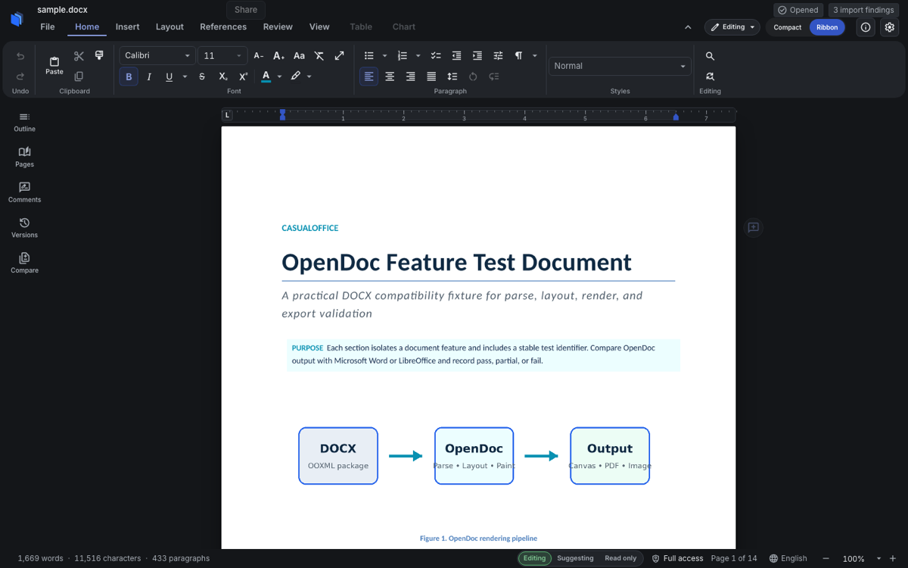
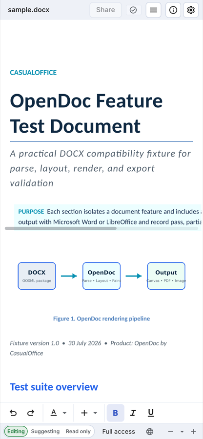
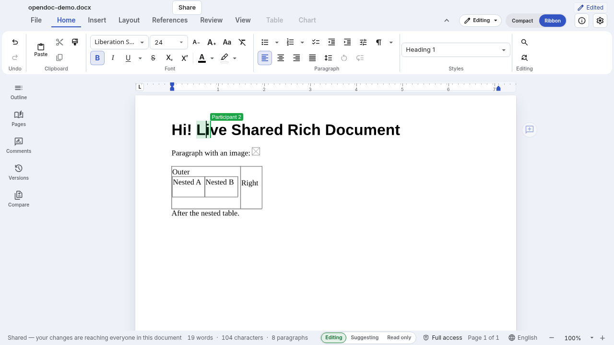

<p align="center">
  
</p>

<h1 align="center">OpenDoc</h1>

<p align="center">
  <strong>An Apache-2.0, embeddable, local-first editor for Word documents —<br />
  and the deterministic Rust engine underneath it.</strong>
</p>

<p align="center">
  <a href="https://opendoc.casualoffice.org"></a>
  <a href="docs/06-ROADMAP-AND-DELIVERY.md"></a>
  <a href="rust-toolchain.toml"></a>
  <a href="LICENSE"></a>
</p>

<p align="center">
  <a href="https://opendoc.casualoffice.org/editor.html?demo=1"><strong>Try the editor</strong></a> ·
  <a href="https://opendoc.casualoffice.org">Website</a> ·
  <a href="https://opendoc.casualoffice.org/embedding.html">Embedding guide</a> ·
  <a href="docs/00-README.md">Docs</a>
</p>

[](https://opendoc.casualoffice.org/editor.html?demo=1)

OpenDoc reads and writes `.docx`, holds the document in a normalized editable model,
lays it out and paints it itself, and runs the same engine natively, headless, or in
the browser as WebAssembly. **Nothing has to run behind it**: the editor opens, edits
and saves a document entirely in the tab.

It is built as an open alternative to ONLYOFFICE Docs for documents — one you can
embed and brand without a commercial licence.

## Part of CasualOffice

OpenDoc is one of two sibling projects from [CasualOffice](https://github.com/CasualOffice),
both Apache-2.0, both a Rust engine with a WebAssembly editor:

| Project | What it edits | Links |
| --- | --- | --- |
| **OpenDoc** (this repo) | Word documents — `.docx`, `.odt`, `.rtf`, `.txt` | [site](https://opendoc.casualoffice.org) · [repo](https://github.com/CasualOffice/opendoc) |
| **[OpenCalc](https://github.com/CasualOffice/opencalc)** | Spreadsheets — an Excel-compatible editor for `.xlsx`, `.xlsm` and `.ods` | [site](https://calc.casualoffice.org) · [repo](https://github.com/CasualOffice/opencalc) |

## Why OpenDoc

| | |
| --- | --- |
| 🛡️ **Loss-aware** | Content the model does not yet represent is kept and written back verbatim, or reported in a compatibility report — never silently dropped. An unedited `.docx` saves back byte-for-byte. |
| 🎯 **Deterministic** | The same input, fonts and engine version produce the same model, layout, pixels and bytes, so rendering is regression-tested, not eyeballed. |
| 💻 **Local-first** | No document server, no upload. The editor is a static web app; drafts and version history live in the browser's own storage. |
| 🧩 **Embeddable** | A custom element, an in-process API and a `postMessage` bridge, with roles, capabilities and build-time white-labelling. No React, DOM-as-model, or mandatory collaboration provider. |
| 🔒 **Safe with untrusted files** | Packages are parsed under explicit entry, path, size, expansion and resource limits, and macro-enabled `.docm` files are refused. |

## See it

<table>
  <tr>
    <td width="62%"></td>
    <td width="38%"></td>
  </tr>
  <tr>
    <td align="center"><sub>Desktop, dark theme</sub></td>
    <td align="center"><sub>Phone layout with touch selection</sub></td>
  </tr>
  <tr>
    <td colspan="2"></td>
  </tr>
  <tr>
    <td colspan="2" align="center"><sub>Real-time co-editing (experimental) with remote cursors and selections</sub></td>
  </tr>
</table>

## What the editor does today

| Area | Highlights |
| --- | --- |
| **Write and format** | Styles (create and update from the selection), fonts, colours, spacing and indents, tab stops and the ruler, lists and multilevel numbering, format painter, smart quotes, change case, drop caps |
| **Tables** | Insert, merge and split, borders and shading, cell formatting, row/column operations, move and reorder |
| **Objects** | Pictures (crop, rotate, wrap, alt text, group); shapes (22 to insert; all 187 DrawingML presets and custom geometry render); text boxes; charts drawn by the engine (bar, column, line, area, scatter, pie, doughnut), insertable, with an editable data grid, saved back into the `.docx` |
| **Structure** | Headers and footers (first-page and odd/even), footnotes and endnotes, sections and breaks, page setup, line numbers, watermarks, a generated table of contents, captions and cross-references, bookmarks, hyperlinks and fields |
| **Review** | Threaded comments with replies and resolve; tracked changes with Editing / Suggesting / Viewing modes, per-author colours, accept and reject one or all; the document's own Track Changes setting honoured; Restrict Editing (read-only, comments, tracked changes, forms) |
| **Versions and compare** | A version timeline with named versions, a read-only preview with changes painted on the page, non-destructive restore; compare against another file as a redline or as tracked changes |
| **Proofing** | Offline spell check (English, US and UK) and grammar rules in a worker, with a personal dictionary |
| **Views** | Paper layout, an editable pageless reflow view, a phone layout with touch selection, outline pane, folding headings, page thumbnails, zoom, dark theme |
| **Everyday tools** | Find and replace, print (as real-text PDF), document statistics, command palette, keyboard shortcuts |
| **Accessibility** | A screen-reader mirror of the document's structure (headings, lists, tables, alt text), F6 region navigation, arrow-key ribbon navigation and key tips; WCAG contrast measured in CI |
| **Languages** | 19 interface languages (machine-translated, marked as such), with a mirrored chrome for right-to-left languages |

## Formats

| Format | Open | Save / export |
| --- | :---: | :---: |
| Word (`.docx`) | ✅ | ✅ byte-identical when unedited |
| Word template (`.dotx`) | — | ✅ |
| OpenDocument Text (`.odt`) | ✅ | ✅ |
| Rich Text (`.rtf`) | ✅ | — |
| PDF | — | ✅ real, selectable text with embedded, subsetted fonts |
| Web page (`.html`) | — | ✅ one self-contained file, styled the way the page is |
| Markdown (`.md`) | — | ✅ |
| Plain text (`.txt`) | ✅ | ✅ |
| Normalized JSON snapshot | ✅ | ✅ |

Every export reports what it could not carry. A `.docm` file is refused at open.

## Quickstart

**Run the editor locally** (requires [Rust](https://www.rust-lang.org/tools/install)
and [wasm-pack](https://drager.github.io/wasm-pack)):

```sh
git clone https://github.com/CasualOffice/opendoc.git && cd opendoc
./webapp/build.sh     # compile the engine to webapp/pkg and build the pages
./webapp/serve.py     # serve on http://localhost:8099 with no-cache headers
# open http://localhost:8099/editor.html?demo=1
```

**Or as a container** — `docker compose up` starts the editor alone, with no server
behind it ([deployment](docs/162-DEPLOYMENT-CONTAINERS-AND-CONFIGURATION.md)).

**Or drive the engine** — test the workspace, and render the first page of a bundled
sample to a PNG through the whole pipeline (import → paginate → compose → raster):

```sh
cargo test --workspace --all-features --locked
cargo run -p casual-doc-render --example render_docx_page -- page.png
```

## Embed it

Put the editor in your page as `<opendoc-editor>` (from
[`packages/opendoc-embed`](packages/opendoc-embed), not yet published to npm), drive it
in-process through `window.opendoc`, or from another origin through a versioned
`postMessage` contract with an explicit origin allowlist.

- **The host decides** the role (preview, read-only, commenter, editor, owner), the
  capabilities (open, save, download, print, edit, comment, autosave, branding) and
  the chrome.
- **The host hears** `ready`, `change`, `selection`, `save`, `export`, `error` and
  `refusal` events.
- **Not yet:** a host cannot hand a document to the editor by URL or bytes; the user
  opens it.

Read the [embedding guide](https://opendoc.casualoffice.org/embedding.html), try the
[configuration playground](https://opendoc.casualoffice.org/playground.html), or see
[the SDK plan](docs/126-EMBEDDABILITY-AND-SDK-THREE-PHASE-PLAN.md).

<details>
<summary><strong>Use the engine directly from Rust</strong></summary>

```rust
use casual_doc_import::{import_package, ImportConfig, ImportMode};
use casual_doc_ooxml::{DocxPackage, PackageLimits};

let bytes = std::fs::read("document.docx")?;
let mut package = DocxPackage::open(&bytes, PackageLimits::default())?;
let outcome = import_package(
    &mut package,
    ImportConfig { mode: ImportMode::Semantic, ..ImportConfig::default() },
)?;

let document = outcome.document;
// `document` is the normalized model: paragraphs, runs, styles, tables, …
// Anything not yet modeled is captured in the compatibility report, not lost.
```

</details>

## Collaboration (experimental)

Real-time co-editing is operational transformation over the same transactions the
editor already uses ([ADR-033](docs/08-ADR-REGISTER.md)), plus an optional relay,
`opendoc-relay`, that orders and forwards changes and **never holds the document**
(ADR-047). Rooms carry a role — viewer, commenter, suggester, editor or owner — that
caps every participant.

The editor shows remote cursors and selections. Share uses an optional host provider
to persist a document and create a link that opens it. Unsupported transforms preserve
pending work during snapshot recovery, and uncertain edits stay downloadable as
backups. The public demo has no Share host.

```sh
docker compose run --rm relay create /var/lib/opendoc-relay/room.journal
docker compose --profile relay up --build
# then open the editor with ?room=ws://localhost:7070
```

More: [sharing and recovery](docs/169-SHARING-PRESENCE-AND-SNAPSHOT-RECOVERY.md) ·
[relay deployment §5](docs/162-DEPLOYMENT-CONTAINERS-AND-CONFIGURATION.md).

## Status

**Pre-release.** The editor is usable and tested end to end, but the public SDK
surfaces are not stable and the internal crates are not published.

| Area | State |
| --- | --- |
| Engine: model, import, semantic DOCX writer | Built |
| Layout, pagination, CPU rendering, PDF | Built, improving in fidelity |
| Browser editor (`webapp/`) | Built and tested end to end, pre-release |
| Review, versions, compare | Built |
| Embedding: element, API, `postMessage` contract | Built; package not yet published |
| Real-time collaboration | Experimental: OT engine, relay, presence, Share and safe recovery built; relay TLS, authentication and a published image not yet |
| Stable public SDK and published crates | Planned |
| Desktop shell, GPU backend | Not started |

<details>
<summary><strong>Known limitations</strong></summary>

All tracked in [the backlog](docs/109-BACKLOG.md):

- **Rendering is not yet identical to Word.** It is measured against LibreOffice as an
  oracle ([fidelity harness](docs/94-ORACLE-VISUAL-FIDELITY-HARNESS-DESIGN.md)); there
  is no automatic hyphenation, and the character grid (`charSpace`) is not applied.
- **SmartArt** is kept for round trip and shown as a placeholder; **3-D, radar,
  surface, stock and bubble charts** likewise. Equations render and round-trip but
  cannot be edited or inserted.
- **RTF** opens but cannot be saved. The **PDF** export has no tags, links, bookmarks
  or PDF/A yet, and does not carry colour emoji.
- **Collaboration** is experimental; version history is stored in the browser, not on
  a server.
- **Spell check** is English only, and the 18 non-English interface languages are
  machine-translated and not yet reviewed.
- 20 of the 24 document font faces are served by the editor itself; the CJK and
  colour-emoji faces come from a pinned, hash-verified mirror unless the deployment
  provisions them. There is no offline service worker.
- Not authorable yet: drawing custom shape geometry, creating SmartArt, and a recent
  files list.

More: [support matrix](docs/18-SUPPORT-MATRIX.md) ·
[ONLYOFFICE parity matrix](docs/153-ONLYOFFICE-CAPABILITY-PARITY-MATRIX.md) ·
[what is still missing](docs/99-REMAINING-WORK-AUDIT.md).

</details>

## How it is built

The editor is a thin shell over a Rust engine that owns everything a document is:

```
 .docx / .odt / .rtf ──▶ import ──▶ normalized model ──▶ layout ──▶ display list ──▶ pixels · PDF
                                        ▲      │
                       edit operations ─┘      └──▶ DOCX · ODT · HTML · Markdown · text
                       (transactions: undo, history, collaboration)
```

- **Import** — WordprocessingML, ODF and RTF into one normalized, versioned model.
- **Editing** — a closed operation set applied through transactions, each with its
  inverse, so undo/redo, collaboration and history share one mutation path.
- **Layout and paint** — shaping and line breaking with
  [`parley`](https://github.com/linebender/parley), a full style cascade, pagination
  with keep and widow rules, floats with contour wrapping, all 187 ECMA-376 preset
  shapes, charts and math, into a backend-neutral display list.
- **Output** — a CPU rasterizer ([`tiny-skia`](https://github.com/RazrFalcon/tiny-skia)
  with [`skrifa`](https://github.com/googlefonts/fontations) outlines, including COLR
  and bitmap colour glyphs), a vector PDF writer, and DOCX, ODT, HTML, Markdown and
  text writers.
- **Diff** — a structural comparison of two documents that drives version history and
  Compare.

<details>
<summary><strong>Workspace crates and tools</strong></summary>

| Crate | Responsibility |
| --- | --- |
| `casual-doc-model` | Normalized document values, IDs, invariants, and snapshot I/O |
| `casual-doc-package` | Format-neutral, security-bounded ZIP admission and part reads |
| `casual-doc-ooxml` | Security-bounded DOCX package admission and on-demand part reads |
| `casual-doc-import` | WordprocessingML import into the normalized model |
| `casual-doc-odf` | Security-bounded ODF admission, ODT import, and bounded ODT writing |
| `casual-doc-rtf` | Security-bounded RTF admission and import |
| `casual-doc-export` | DOCX writers: byte-identical re-emission and the semantic model → WordprocessingML writer, charts included |
| `casual-doc-pdf` | Real-text vector PDF from the shared display list, with subsetted embedded fonts |
| `casual-doc-io` | Format identities, capability descriptors, detection, the adapter registry, and the HTML, Markdown and text writers |
| `casual-doc-edit` | The closed set of editing operations, each returning its inverse |
| `casual-doc-transaction` | Transactions and the ordered revision log — the one mutation path — plus the collaboration session and transform |
| `casual-doc-selection` | Validated caret, text-range and table-cell-range selection |
| `casual-doc-diff` | Structural difference between two documents, for version history and Compare |
| `casual-doc-layout` | Style cascade, shaping, flow, pagination, charts and shapes, and the backend-neutral display list |
| `casual-doc-render` | CPU rasterization of the display list (`tiny-skia`, `skrifa`, colour glyphs) |
| `casual-doc-sdk` | Host-facing engine and document-session facade |
| `casual-doc-viewer` | Read-only cut for the Viewer and headless SDKs: open, paginate once, render pages, PDF; no editing crates (`docs/176`) |
| `casual-doc-wasm` | WebAssembly bridge: the document session, edit operations and page raster the editor drives |
| `opendoc-relay` (`server/`) | Optional collaboration relay that orders and forwards changes and holds no document |

**Tooling:** `tools/opendoc-benchmark` (reproducible workloads and baselines),
`tools/opendoc-fidelity` (geometry and text compared against LibreOffice),
`tools/opendoc-parity` (derives the [ONLYOFFICE parity
matrix](docs/153-ONLYOFFICE-CAPABILITY-PARITY-MATRIX.md)), `tools/opendoc-render`
(batch page renders for visual regression), and `fuzz/` (independently locked
package-reader fuzz targets). The browser editor and the developer site are in
[`webapp/`](webapp/).

**Toolchain:** the repository pins Rust **1.96.0** through `rust-toolchain.toml` and
supports Rust **1.88.0** as its minimum (MSRV). Every pull request runs format, lint,
tests, docs, WebAssembly, browser, fuzz-build and benchmark gates on the pinned
toolchain, the full test suite on Windows and macOS, and an all-target check on the
MSRV.

</details>

## Documentation

The numbered documents in [`docs/`](docs/) are the source of truth for architecture,
behaviour and compatibility ([index](docs/00-README.md)). Good entry points:

[Architecture](docs/02-ARCHITECTURE.md) ·
[Decisions (ADRs)](docs/08-ADR-REGISTER.md) ·
[SDK API](docs/05-SDK-API-SPEC.md) ·
[Editor architecture](docs/56-EDITOR-SHELL-AND-RENDER-ARCHITECTURE.md) ·
[Collaboration protocol](docs/152-COLLABORATION-PROTOCOL-SESSION-AND-IDENTITY.md) ·
[Deployment](docs/162-DEPLOYMENT-CONTAINERS-AND-CONFIGURATION.md) ·
[Roadmap](docs/106-ONLYOFFICE-ALTERNATIVE-ROADMAP.md) ·
[Backlog](docs/109-BACKLOG.md)

## Contributing

Contributions are welcome through issues and pull requests. Substantial behaviour and
architecture changes follow a design-first workflow: define the outcome, record the
evidence and alternatives, agree the design, add the row to
[the backlog](docs/109-BACKLOG.md), then implement with tests, docs and CI coverage.

Start with [CONTRIBUTING.md](CONTRIBUTING.md), and please follow our
[Code of Conduct](CODE_OF_CONDUCT.md). [GOVERNANCE.md](GOVERNANCE.md) records who
decides what. Questions, ideas and bugs (with a minimal, non-confidential
reproduction) go to [GitHub issues](https://github.com/CasualOffice/opendoc/issues).

## Security

Do not report vulnerabilities, malicious fixtures, or confidential documents in public
issues. Follow [SECURITY.md](SECURITY.md) and use
[GitHub private vulnerability reporting](https://github.com/CasualOffice/opendoc/security/advisories/new).

## License

Copyright 2026 CasualOffice, developed by the CasualOffice Team, and licensed under the
[Apache License 2.0](LICENSE). Unless you state otherwise, a contribution you submit
for inclusion is provided under Apache-2.0, without additional terms or conditions.

[NOTICE](NOTICE) carries the attribution notice and the third-party works this
repository ships — the bundled document fonts, the interface fonts, and the SCOWL word
lists behind the spelling dictionaries — each with the committed license file it is
taken from.
